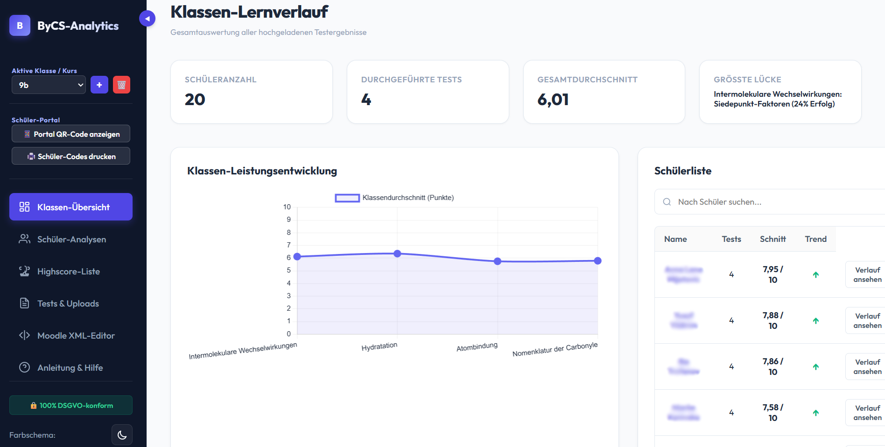
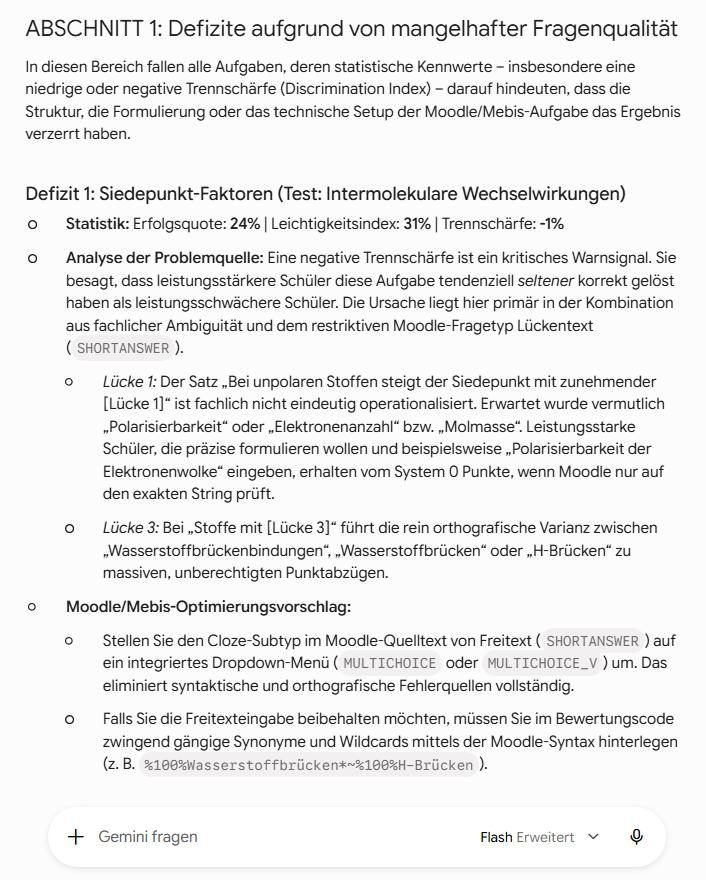
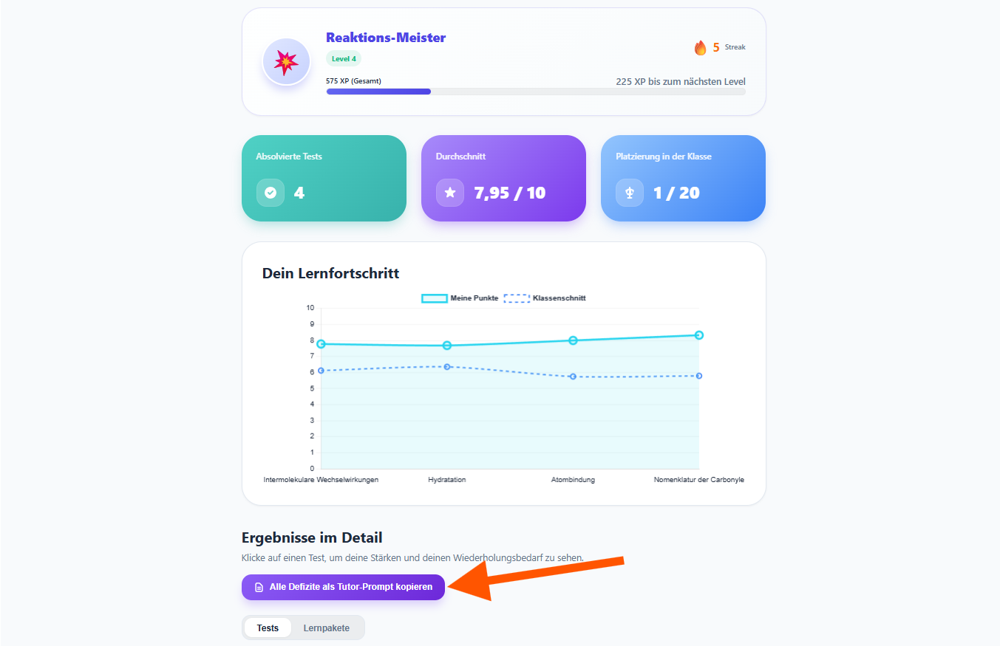
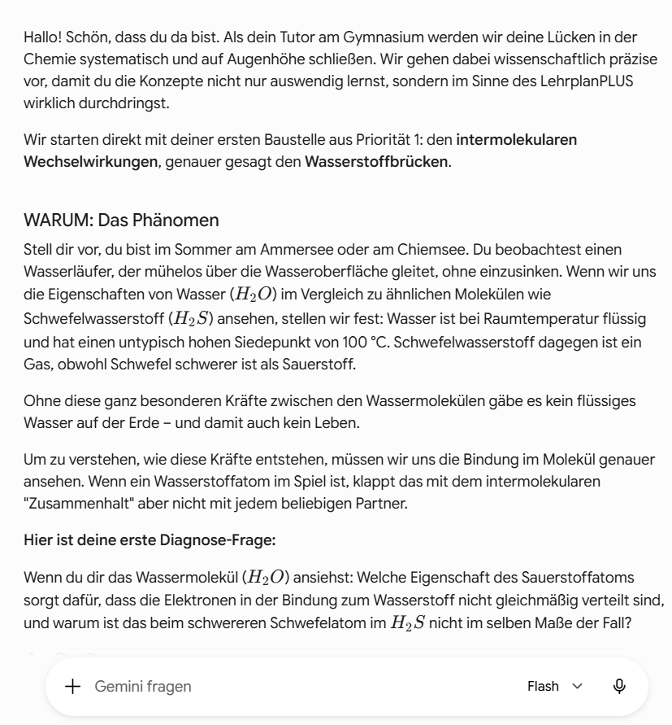

# 🎓 ByCS-Dashboard & KI-gestützte Moodle-Analyse

> Didaktisches Analyse- und Diagnose-Dashboard für Moodle- und ByCS-Tests: Automatisierte Notenspiegel, Trennschärfen-Analyse, anonymes Schüler-Portal und sokratische KI-Lernbegleiter.


---

## 🖥️ Interaktive Feature-Präsentation

> 💡 **Tipp:** Eine vollständige, interaktive Präsentation aller Funktionen mit Folienmodus, Screenshots und didaktischen Erläuterungen finden Sie direkt in:
> 
> 👉 **[`presentation.html` (Hier klicken oder im Browser öffnen)](presentation.html)**

---

## 📌 Didaktischer Hintergrund

Digitale Tests auf Lernplattformen wie **ByCS (BayernCloud Schule)**, **mebis** oder **Moodle** liefern Lehrkräften oft nur unübersichtliche Punktetabellen. 

Das **ByCS-Dashboard** schließt die Lücke zwischen Testergebnis und gezieltem Unterricht:
Es verwandelt Rohdaten in **didaktische Handlungsempfehlungen** für die Lehrkraft und gibt Schüler:innen über ein **anonymes Portal** die Möglichkeit, Wissenslücken mit einem **sokratischen KI-Tutor** selbstständig und aktiv zu schließen.

---

## ✨ Die 6 Kern-Module

```
   ┌─────────────────────────────────────────────────────────────┐
   │                     ByCS-Dashboard                          │
   └───────────────┬─────────────────────────────┬───────────────┘
                   │                             │
       ┌───────────▼───────────┐     ┌───────────▼───────────┐
       │   Lehrkraft-Bereich   │     │   Schüler:innen-Portal│
       ├───────────────────────┤     ├───────────────────────┤
       │ • Notenspiegel        │     │ • Anonyme Einzeleinsicht│
       │ • Trennschärfen       │     │ • Fehlerschwerpunkte  │
       │ • Top-5 Defizite      │     │ • Sokratischer Tutor  │
       │ • KI-Didaktik-Prompt  │     │ • Reflexions-Tool     │
       └───────────────────────┘     └───────────────────────┘
```

### 1. 📊 Klassenübersicht & Notenspiegel
- Automatische Notenberechnung nach konfigurierbaren Notenschlüsseln (Gymnasium, Realschule, IHK).
- Visualisierung der Notenverteilung und des Klassendurchschnitts.
- Detaillierte Schülerliste mit Gesamtpunktzahl, Bearbeitungszeit und Leistungsrang.
- Optionale Gamification mit Highscore-Bestenlisten für motivierende Übungsphasen.

### 2. 🎯 Fragenanalyse & Trennschärfen (Diskriminationsindex)
- **Erfolgsquote je Aufgabe:** Sofort erkennen, welche Fragen von der Mehrheit gelöst wurden.
- **Trennschärfe-Berechnung:** Statistische Prüfung, ob eine Frage zuverlässig zwischen leistungsstarken und leistungsschwachen Lernenden unterscheidet.
- **Top-5-Klassendefizite:** Automatische Aggregation der häufigsten Fehlkonzepte der gesamten Lerngruppe.

### 3. 🤖 Automatisierte Didaktische KI-Analyse
- Per Knopfdruck generiert das Dashboard einen präzise instruierten **Didaktik-Prompt** für moderne Sprachmodelle (ChatGPT, Claude, Gemini).
- Die KI analysiert typische Fehlermuster und schlägt konkrete Unterrichtseinstiege, Erklärungen und Differenzierungsaufgaben für die Folgestunde vor.

### 4. 🛡️ Anonymes Schüler-Portal (`student_portal/`)
- Schüler:innen erhalten über Pseudonyme oder PINs Zugriff auf ihr persönliches Ergebnis.
- **Vollständig anonym:** Niemand sieht die Noten oder Fehler anderer Mitschüler.
- Übersicht über persönliche Stärken und konkrete Fehlaufgaben.

### 5. 🧠 Sokratischer KI-Lernbegleiter
- Zu jeder falsch gelösten Aufgabe kann die Schülerin / der Schüler einen individuellen **Tutor-Prompt** kopieren.
- **Kein Vorrechnen:** Der KI-Tutor agiert nach dem sokratischen Prinzip. Er gibt Denkanstöße, stellt gezielte Gegenfragen und führt die Lernenden Schritt für Schritt zur Selbsterkenntnis.

### 6. ✏️ Integrierter Moodle-XML-Editor
- Moodle-XML-Fragensammlungen direkt im Browser öffnen, visuell prüfen, korrigieren und exportieren – ohne XML-Syntaxfehler.

---

## 📸 Screenshots & Einblicke

| Klassenübersicht & Noten | Didaktische KI-Defizitanalyse |
| :---: | :---: |
|  |  |

| Schüler-Feedback-Portal | Sokratischer KI-Tutor |
| :---: | :---: |
|  |  |

---

## 🚀 Schnelleinstieg & Workflow

### Workflow im Unterricht:
1. **Test durchführen:** Führen Sie einen Moodle- bzw. mebis-Test mit Ihrer Klasse durch.
2. **Export herunterladen:** Exportieren Sie die Testergebnisse als XML, JSON oder CSV.
3. **Im Dashboard öffnen:** Ziehen Sie die Datei einfach per Drag & Drop in `index.html`. Die Auswertung erfolgt **100% lokal im Browser** (keine Datenübertragung an fremde Server).
4. **Didaktik nutzen:** Nutzen Sie die KI-Analyse für Ihre Unterrichtsnachbereitung.
5. **Förderung aktivieren:** Stellen Sie den Schüler:innen das Schülerportal (`student_portal/student.html`) für die eigenverantwortliche Nacharbeit zur Verfügung.

---

## 📁 Projektstruktur

```text
├── index.html                   # Haupt-Dashboard für Lehrkräfte (Analyse & Visualisierung)
├── styles.css                   # Modernes, klares UI-Design
├── app.js                       # Analyse-Logik, Notenberechnung, Trennschärfen & KI-Prompt-Engine
├── demo_data.js                 # Integrierter Demo-Datensatz zum sofortigen Ausprobieren
├── presentation.html            # Interaktive Feature-Präsentation für Beamer & Konferenzen
├── json-Vorlage.json            # Beispiel-Struktur für Moodle-Imports
├── Test_Hydratation.xml         # Beispielhafter Chemie-Test zur Demonstration
│
├── student_portal/              # Das anonyme Schülerportal
│   ├── student.html             # Schüleransicht für Feedback & Tutor-Prompt
│   ├── student_app.js           # Client-Logik für Einzelauswertung
│   └── data_test.json           # Testdaten für Schüleransicht
│
├── Reflexionsdashboard/         # Ergänzendes Reflexions-Tool
│   └── Reflexions-Tool.html     # Begleitendes Selbsteinschätzungs-Instrument
│
├── api/                         # Optionaler Speicher-Endpunkt für Server-Hosting
│   └── upload.php               # Raum-basierter JSON-Speicher
│
├── img/                         # Screenshots für Dokumentation & Präsentation
│   ├── Klassenuebersicht.jpg
│   ├── Detailansicht_Lehrer.jpg
│   ├── Fragenanalyse.png
│   ├── Defizitanalyse_KI1.png
│   ├── Defizitanalyse_KI2.png
│   ├── Tutorprompt.png
│   ├── Highscores.jpg
│   └── xml-editor.png
│
├── LICENSE                      # Freie MIT-Lizenz
└── README.md                    # Projektdokumentation
```

---

## 🔒 Datenschutz & DSGVO

- **Clientseitige Verarbeitung:** Die Auswertung von Schülernamen und Noten erfolgt standardmäßig lokal im Browser des Lehrers. Es fließen keine personenbezogenen Schülerdaten über das Internet ab.
- **Keine Tracking-Cookies, keine externen Werbenetzwerke.**
- **Datensparsamkeit:** Das Schüler-Portal funktioniert ohne Benutzerkonten über temporäre Raum-IDs oder Pseudonyme.

---

## 📄 Lizenz

Dieses Projekt ist unter der [MIT-Lizenz](LICENSE) lizenziert – freie Nutzung und Weiterentwicklung für Schulen, Lehrkräfte und Bildungseinrichtungen.
